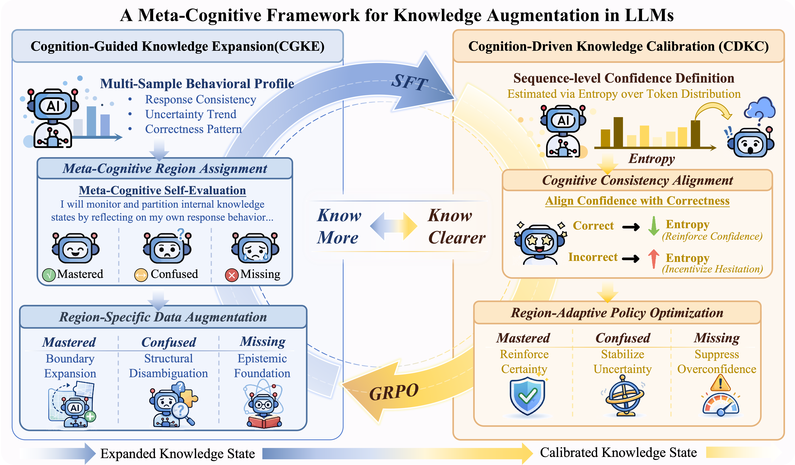

# Know More, Know Clearer: A Meta-Cognitive Framework for Knowledge Augmentation in Large Language Models

<p align="center">
  <a href="https://github.com/AI9Stars/Know-More-Know-Clearer" alt="GitHub">
    
  </a>
  <a href="https://arxiv.org/abs/2602.12996" alt="Paper">
    
  </a>
</p>

This repository is the official implementation of [Know More, Know Clearer: A Meta-Cognitive Framework for Knowledge Augmentation in Large Language Models](https://arxiv.org/abs/2602.12996).



Knowledge augmentation is not merely a matter of acquiring more knowledge, but of **knowing more clearly what the model knows and what it does not**. Our framework has two halves, and this repository ships both:

| | Half | What it does | Where |
|---|---|---|---|
| **Know More** | Cognition-Guided Knowledge Expansion (CGKE) | Probes the model's knowledge boundary by repeated sampling, partitions every instance into a **Mastered / Confused / Missing** region, synthesizes the augmentation that region calls for, and fine-tunes on it. | [`Know-More/`](./Know-More) |
| **Know Clearer** | Cognition-Driven Knowledge Calibration (CDKC) | GRPO fine-tuning with a cognitive consistency objective: **reinforce confidence when correct, incentivize hesitation when wrong**. | [`Know-Clearer/`](./Know-Clearer) |

The checkpoint CGKE's fine-tuning produces *is* the "Know More" model, and it is what CDKC starts calibrating.

## ⚙️ Requirement

Use **separate environments** for the three stages. Data construction is a light client that only talks to a vLLM server and needs no GPU stack of its own; the two training stages each pull in their own trainer.

**(a) Know-More — data construction**

```txt
python==3.10
openai>=1.0
numpy>=1.23
PyYAML>=6.0
tqdm>=4.65
```

**(b) Know-More — SFT warm-up**

```txt
python==3.10
torch
transformers
trl
peft
deepspeed
datasets
```

**(c) Know-Clearer — GRPO training**

```txt
python==3.10
torch
vllm==0.8.4
transformers
ray[default]
tensordict<=0.6.2
flash-attn
accelerate
peft
wandb
```

📌 *The full pinned list for the RL half lives in `Know-Clearer/verl/requirements.txt`; verl must be installed in editable mode so the modified files in this fork take effect.*

## 🔎 Know More: Cognition-Guided Knowledge Expansion

### 🗂️ Prepare the Environment and Seed Data

#### (1) Clone the Repository

```bash
git clone https://github.com/AI9Stars/Know-More-Know-Clearer
cd Know-More-Know-Clearer/Know-More

conda create -n knowmore python=3.10 -y && conda activate knowmore
pip install -e .
```

#### (2) Construct `seed dataset`

All raw data should be converted into a standardized JSON-Lines format. **Each sample must contain the following two required fields:**

```json
{
  "question": "",   // The input question (str)
  "answer": ""      // The ground truth answer to the question (str)
}
```

📌 *Our runs used 50k NQ + 30k HotpotQA + 30k 2WikiMQA as the seed set.*

#### (3) Serve the Backbone Model

Every stage talks to an OpenAI-compatible vLLM endpoint. Download [Qwen2.5-7B-Instruct](https://huggingface.co/Qwen/Qwen2.5-7B-Instruct) or [Llama-3.1-8B-Instruct](https://huggingface.co/meta-llama/Llama-3.1-8B-Instruct) as the vanilla model, then:

```bash
python -m vllm.entrypoints.openai.api_server \
    --model /path/to/Qwen2.5-7B-Instruct \
    --dtype bfloat16 --port 7999 --tensor-parallel-size 1 --trust-remote-code
```

Copy `configs/example.yaml`, set `endpoint.model` and `input_path`, and pass that file to every stage below.

### 🕵️ Knowledge Boundary Diagnosis

This stage probes what the model actually knows. It samples the model repeatedly, then lets the model read its own behavior and partition itself into three knowledge regions.

#### (1) Behavioral Profiling

```bash
knowmore sample --config configs/my_run.yaml
```

📌 *Draws K = 16 independent responses per query, recording correctness and token-level uncertainty to form the behavior profile B(q, a). This is the expensive stage — K × |dataset| generations. Start with `--set sampling.n_samples=4` on a few thousand questions to size a full run.*

#### (2) Meta-Cognitive Region Assignment

```bash
knowmore diagnose --config configs/my_run.yaml
```

📌 *The model reads its own profile and assigns each instance to Mastered, Confused, or Missing. Records that fail the model call are kept and tagged `assignment_source: "fallback"` rather than dropped, so you can measure how much of a run took a degraded path.*

#### (3) Cognitive Tagging and Query Generation

```bash
knowmore meta --config configs/my_run.yaml
```

📌 *Extracts Cognitive Tags — the critical entities and logical prerequisites underlying the diagnosed state — and formulates one high-precision retrieval query anchored on them.*

### 🛠️ Region-Specific Knowledge Augmentation

#### (1) Retrieve External Grounding Passages

Retrieval runs out-of-process, so this stage has two halves: export the queries, run your engine, merge the results back.

```bash
knowmore retrieve --config configs/my_run.yaml --export queries.jsonl
#   ... run your retriever over queries.jsonl ...
knowmore retrieve --config configs/my_run.yaml --results engine_out.json --top-k 5
```

📌 *Our runs used [UltraRAG](https://github.com/OpenBMB/UltraRAG) with `Qwen3-Embedding-0.6B` over Wikipedia, retrieving top-5 contexts. Nothing here is UltraRAG-specific — this stage only needs a mapping from query text to passage strings, so any engine works.*

#### (2) Region-Conditioned Synthesis

```bash
knowmore synthesize --config configs/my_run.yaml
```

📌 *Each region gets its own generation strategy: **Missing → Epistemic Foundation** (synthesize the missing definitions and factual pillars), **Confused → Structural Disambiguation** (clarify and decompose to stabilize the reasoning chain), **Mastered → Boundary Expansion** (extend to comparisons and broader context).*

#### (3) Build the Training Data

```bash
knowmore build --config configs/my_run.yaml --format sft
```

📌 *Use `--format sft` for the warm-up set (it carries `region`, `meta_query`, and `meta_answer` so the data can be sliced by region or traced back to seed instances), and `--format qa` for the plain pairs the RL half consumes.*

### 🔥 Supervised Fine-Tuning Warm-Up

Train the vanilla model on the augmented instances to obtain the **Know More** checkpoint, which initializes the RL stage. Set the backbone, the two data splits, and an output root, then launch:

```bash
cd sft          # from Know-More/

MODEL_PATH=/path/to/Qwen2.5-7B-Instruct \
TRAIN_DATA_PATH=../runs/my_run/6_train.jsonl \
EVAL_DATA_PATH=/path/to/dev.jsonl \
OUTPUT_ROOT=/path/to/runs \
bash train_sft.sh
```

📌 *TRL + LoRA (r=8, α=32), DeepSpeed ZeRO-2, 1 epoch, lr 1e-5, bf16. Override any of `GPU_VIS`, `LEARNING_RATE`, `MAX_SEQ_LENGTH`, `NUM_TRAIN_EPOCHS`, or `EXPERIMENT_NAME` from the environment. The trainer reads only `question` and `answer`, so the `--format sft` file works as-is and its `region` field stays available for slicing.*

📌 *The resulting checkpoint is what you pass as `MODEL_PATH` to the GRPO stage below.*

## 🎓 Know Clearer: Cognition-Driven Knowledge Calibration

Expansion alone lacks explicit regularization aligning internal confidence with empirical performance. CDKC closes that gap during GRPO: the per-sample entropy term is **sign-flipped by correctness**, so the policy is pushed to be confident on what it knows and hesitant on what it does not.

#### (1) Convert the QA Data to Parquet

The RL half wants the plain `{question, answer}` pairs, so re-run the build step in `qa` format first — it writes to the same path, overwriting the `sft` file:

```bash
cd ../..                            # from Know-More/sft/ back to the repo root
(cd Know-More && knowmore build --config configs/my_run.yaml --format qa)
cd Know-Clearer/verl

python data/data_format.py \
    --input ../../Know-More/runs/my_run/6_train.jsonl \
    --output data/train-clean.parquet --split train

python data/data_format.py \
    --input /path/to/dev.jsonl \
    --output data/dev-clean.parquet --split test
```

📌 *The output parquet carries `data_source="qa-acc"`, which routes it to the accuracy-based reward in `verl/utils/reward_score/qa_acc_reward.py`.*

#### (2) Install verl in Editable Mode

```bash
conda create -n know-clearer python=3.10 -y && conda activate know-clearer
pip install -r requirements.txt
pip install -e .
```

#### (3) Launch GRPO Training

Set the SFT checkpoint and the output root, then launch:

```bash
MODEL_PATH=/path/to/sft_checkpoint \
OUTPUT_ROOT=/path/to/runs \
bash train_scripts/train_meta_cognition.sh
```

📌 *The cognitive consistency objective is implemented in `verl/workers/actor/dp_actor.py`: correct rollouts flip the entropy sign so entropy is minimized (reinforce certainty), while incorrect ones keep it positive so entropy is maximized (incentivize hesitation). The reward itself stays plain answer accuracy — the calibration comes entirely from the entropy term.*

📌 *Reference setup: 4 × A100-80GB, GRPO for 1 epoch, lr 1e-6, `entropy_coeff` = `kl_loss_coef` = 0.001, rollout n = 8.*

## 🎯 Evaluation

Validation runs inside the training loop (`trainer.test_freq=20`) against `dev-clean.parquet`, scoring with the same accuracy metric used for the reward — so the number you watch during training is the number you report.

📌 *Accuracy is normalized answer containment, defined once in `Know-More/knowmore/metrics.py` and mirrored by `qa_acc_reward.py` on the RL side, so the training signal and the reported score never drift apart.*

📌 *Generic verl usage, algorithm coverage, and hardware backends are documented in `Know-Clearer/verl/README_verl_upstream.md`, preserved verbatim from upstream.*

## 📂 Repository Layout

```
Know-More-Know-Clearer/
├── Know-More/                   CGKE — data construction, then the SFT warm-up
│   ├── knowmore/
│   │   ├── prompts.py           ★ every prompt used by the pipeline, in one file
│   │   ├── regions.py             the Mastered / Confused / Missing taxonomy
│   │   ├── config.py              YAML + env + --set resolution
│   │   ├── llm.py                 vLLM client: retries, tolerant JSON extraction
│   │   ├── metrics.py             answer matching, shared with the RL half
│   │   ├── io_utils.py            JSONL read/write, resume support
│   │   ├── cli.py                 the `knowmore` entry point
│   │   └── stages/                s1_sample … s6_build_sft, one per stage
│   ├── configs/example.yaml
│   ├── sft/                       TRL + LoRA + DeepSpeed warm-up
│   └── tests/                     no GPU or server needed
└── Know-Clearer/verl/           CDKC — a verl fork
    ├── verl/workers/actor/dp_actor.py          ★ the entropy sign flip
    ├── verl/utils/reward_score/qa_acc_reward.py  accuracy reward
    ├── data/data_format.py                     JSONL → parquet
    └── train_scripts/train_meta_cognition.sh   the GRPO launcher
```

📌 *The method itself is small. Everything specific to this paper on the RL side is the sign flip in `dp_actor.py` plus the reward function; the rest of `Know-Clearer/verl/` is upstream verl. On the CGKE side, every prompt lives in `knowmore/prompts.py` and nothing else contains prompt text, so the pipeline can be re-aligned by editing one file.*

## 📄 Upstream Code

`Know-Clearer/verl/` is a fork of [volcengine/verl](https://github.com/volcengine/verl), licensed under the Apache License 2.0; its `LICENSE` and `Notice.txt` are preserved unchanged.

## 📖 Citation

If you find this work useful, please cite our paper and give us a shining star 🌟

```
@article{chen2026knowmore,
  title={Know More, Know Clearer: A Meta-Cognitive Framework for Knowledge Augmentation in Large Language Models},
  author={Chen, Hao and He, Ye and Fan, Yuchun and Yan, Yukun and Liu, Zhenghao and Zhu, Qingfu and Sun, Maosong and Che, Wanxiang},
  journal={arXiv preprint arXiv:2602.12996},
  year={2026}
}
```

## ✉️ Contact

If you have questions, suggestions, and bug reports, please email:

```
methanechen@126.com
```
